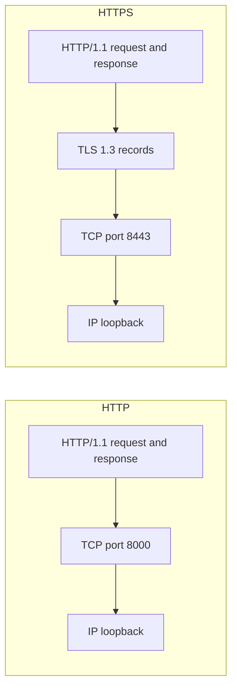
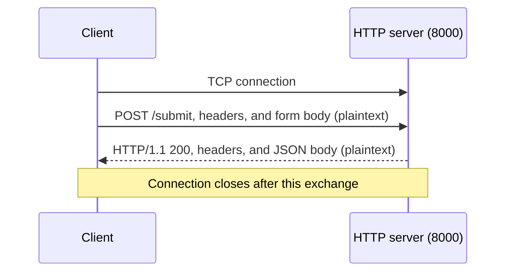
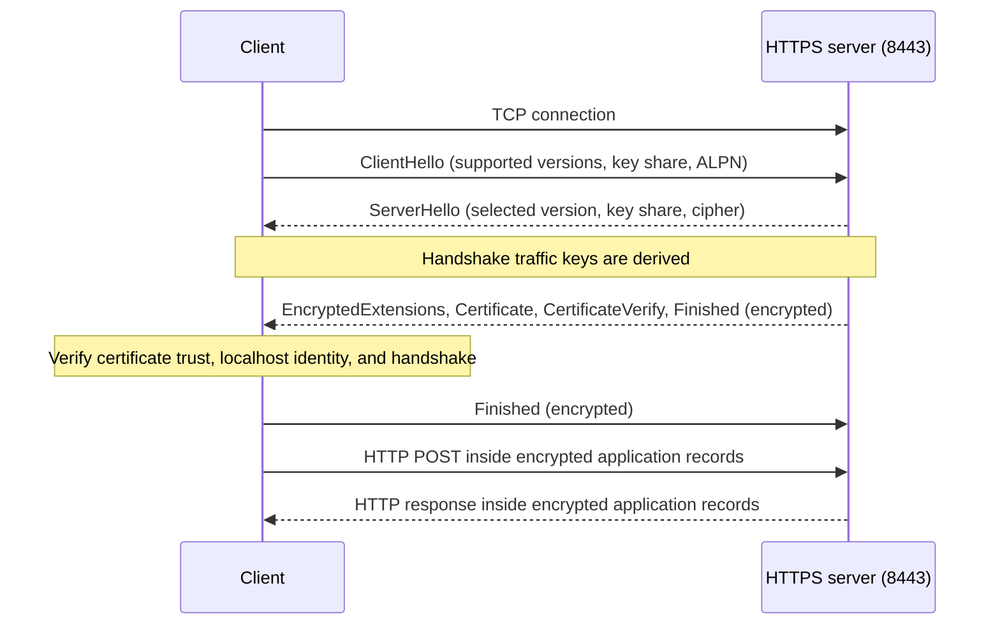

# Protocol architecture

[Quick start](../README.md) | [Demo architecture](demo-architecture.md)

## Protocol layers

The demo submits the same form-encoded `POST /submit` message over two transports.

| Layer | HTTP demo | HTTPS demo |
| --- | --- | --- |
| Application | HTTP/1.1 | HTTP/1.1 |
| Transport protection | None | TLS 1.3 |
| Underlying transport | TCP on port 8000 | TCP on port 8443 |
| Listener address | 127.0.0.1 | 127.0.0.1 |

HTTP/1.1 describes the requests and responses. TLS 1.3 protects the HTTPS
connection; its version is independent of the HTTP version.

Both paths carry the same application data. HTTPS adds TLS protection between
HTTP and TCP.

## HTTP/1.1 and message boundaries

`DemoHandler.protocol_version = 'HTTP/1.1'` selects the server's response version.
The server includes `Content-Length` in JSON responses so a client can identify
where the body ends. The client sends `Connection: close`, making each demo
exchange use its own connection even though HTTP/1.1 supports persistent connections.

The request contains a form field named `message` with the fake value
`ACG_SECRET_2026`. The response echoes it as JSON alongside `secure_transport`.
Over HTTP, the request headers and body are visible in the packet capture.
Over HTTPS, they travel inside protected TLS records.

### Plaintext HTTP exchange

A loopback capture can expose the HTTP headers and body in both directions.

## TLS negotiation and server identity

Both client and server set their minimum and maximum TLS versions to TLS 1.3.
They advertise `http/1.1` through ALPN. The client prints the negotiated TLS
version and cipher before submitting the form.

`setup.py` creates a local CA and a separate server certificate. The server
certificate's subject alternative name is `localhost`, matching the client's
hostname. The server uses its own private key; it does not load the CA private key.

| Client mode | Trust configuration | Expected result |
| --- | --- | --- |
| `http` | No TLS certificate verification | Plaintext POST succeeds |
| `https` | Explicit demo CA file, with hostname verification | Verified TLS connection and POST succeed |
| `untrusted` | System trust roots | Certificate verification fails if the demo CA is absent |

Trusting the demo CA in one client does not add it to the system trust store.
The untrusted mode assumes that the demo CA has not been installed in system roots.

### TLS 1.3 HTTPS exchange

This simplified full handshake shows server authentication without client
certificates. It omits optional retry, compatibility, and session-ticket messages.
The handshake sequence follows [RFC 8446, section 2](https://www.rfc-editor.org/rfc/rfc8446.html#section-2).

A certificate-verification failure in `untrusted` mode prevents the HTTP POST
from being sent. In `https` mode, the client also exports session secrets for
optional packet inspection.

## What the capture reveals

The ServerHello `supported_versions` extension identifies the selected TLS
version. The record-layer version `0x0303` is retained for compatibility; an
initial ClientHello record may also use `0x0301`. Neither field identifies the
negotiated version on its own. The selected key share and cipher suite are visible
in ServerHello. See [RFC 8446, section 5.1](https://www.rfc-editor.org/rfc/rfc8446.html#section-5.1).

Most handshake messages after ServerHello, including the server certificate,
are encrypted. Application data is encrypted as well. The HTTPS client explicitly
writes session secrets to `tls-session-keys.log`; supplying those secrets lets
Wireshark decrypt the matching captured session.

Decryption requires the secrets for the matching session. A packet capture alone
does not provide those secrets.

## Standards / official documentation

- IETF RFC 8446, TLS 1.3: https://www.rfc-editor.org/rfc/rfc8446.html
- Wireshark TLS wiki: https://wiki.wireshark.org/TLS/
- Wireshark loopback capture: https://wiki.wireshark.org/captureSetup/loopback
- Python ssl: https://docs.python.org/3/library/ssl.html
- Python http.server: https://docs.python.org/3/library/http.server.html
